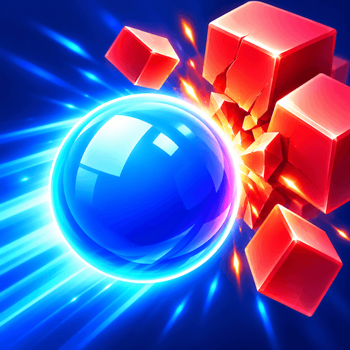
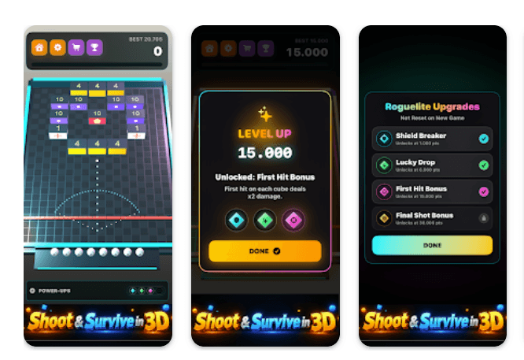

  

<h1 align="center">Ball Shot 3D: Voxel Blocks</h1>

  <b>Aim. Ricochet. Smash. Upgrade. Master the shot.</b>

  

---

## 🎮 About the Game

**Ball Shot 3D** brings classic ball-bouncing action into a vibrant **3D voxel world**, where every shot can trigger a spectacular chain of destruction.

Aim carefully, launch your balls, and watch them ricochet across the arena, smashing colorful voxels from every angle.

Choosing the right target and finding the perfect angle can completely change the outcome of each turn.

---

## 🧊 Special Voxels

- **Medic Voxels** — Restore enemy HP.
- **Shield Voxels** — Absorb incoming balls until they reach their limit and explode.
- **Circle Voxels** — Create wild and unpredictable rebounds.

---

## ⚡ Power-Ups

- **2X Damage** — Deal double damage.
- **Double Balls** — Launch a much larger volley.
- **Freeze** — Stop enemies from advancing for one turn.

---

## 🧬 Rogue-lite Progression

Unlock permanent upgrades that remain active even after starting a **New Game**:

- **Shield Breaker** — Deal **2× damage** to Shield Cubes.
- **Lucky Drop** — Increase Power-Up drop chance by **10%**.
- **First Hit Bonus** — Deal **2× damage** on the first hit to each Cube.
- **Final Shot Bonus** — Your last ball glows gold and deals **2× damage**.

---

## 🎥 Dynamic 3D Camera

Experience every ricochet from different perspectives:

- **Low Camera**
- **High Camera**
- **Follow Last Ball Camera**
- Smooth ball rolling effects
- Clear motion trails
- **Fast Speed Mode**

---

## 💥 Master Every Shot

Colorful voxel destruction, tactical ricochets, permanent upgrades, dynamic cameras, and unpredictable Power-Ups make every turn different.

> **Aim. Ricochet. Smash. Upgrade. Master the shot.**

---

# 📲 Download

  

  

  

---

## 🔗 Official Links

- **Google Play:** https://play.google.com/store/apps/details?id=sam.ball.shot.voxel.blast
- **App Store:** https://apps.apple.com/app/id6812598493
- **YouTube:** https://www.youtube.com/watch?v=U9KE84DEEU4

---

  

  <b>Ball Shot 3D: Voxel Blocks</b> 
  Aim smart. Break everything.

